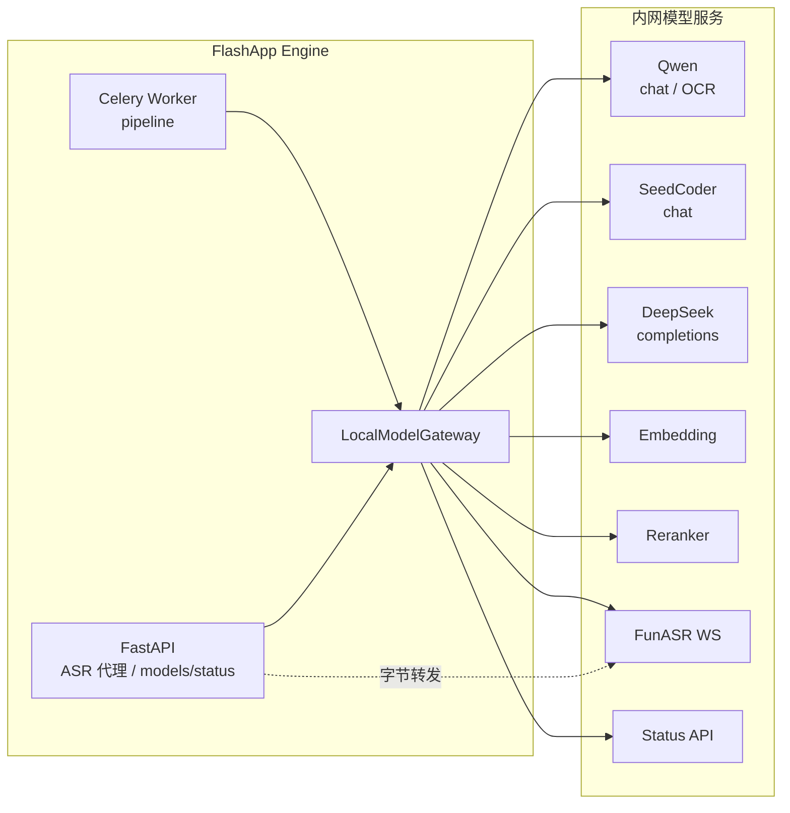
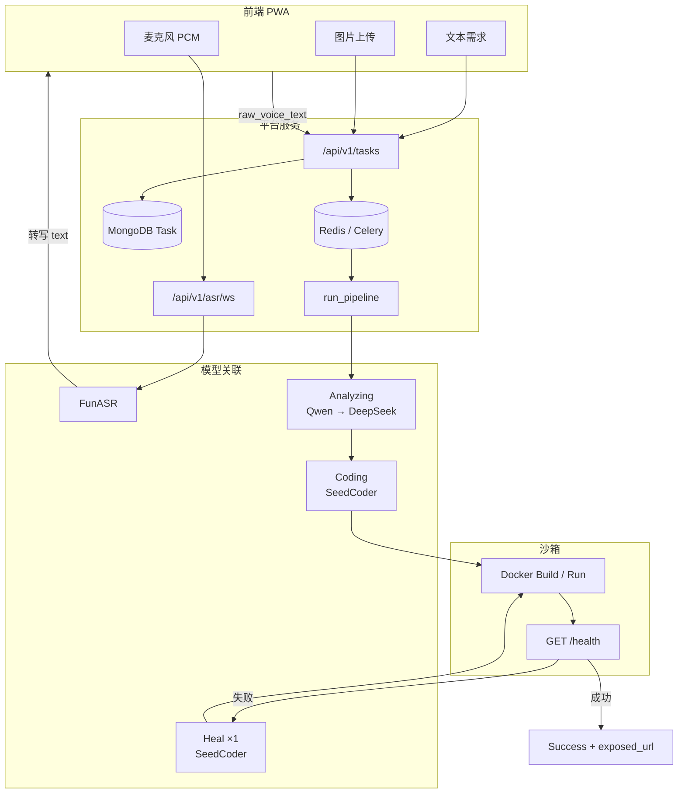
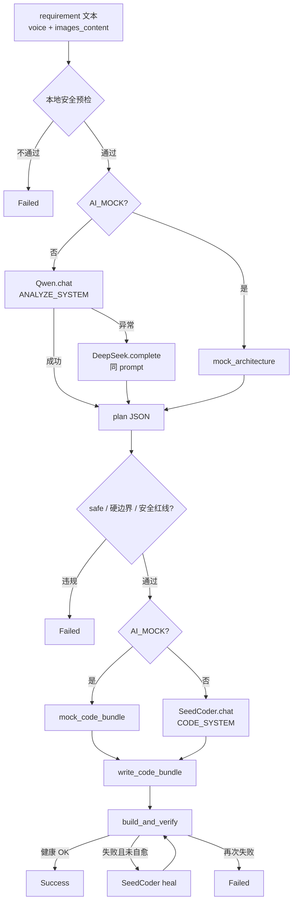
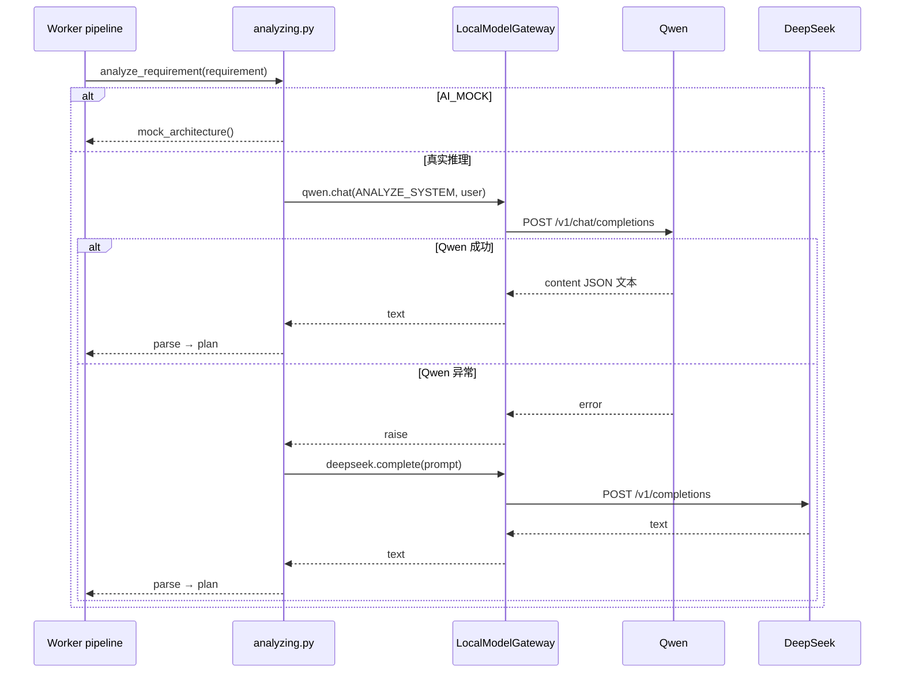
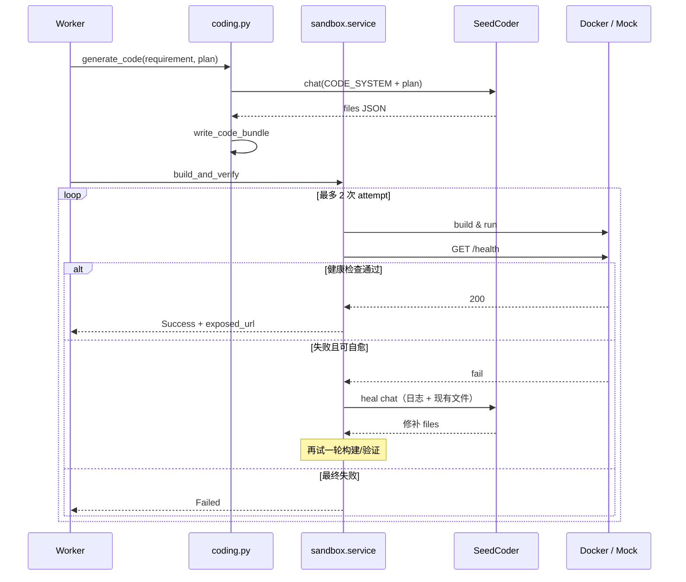
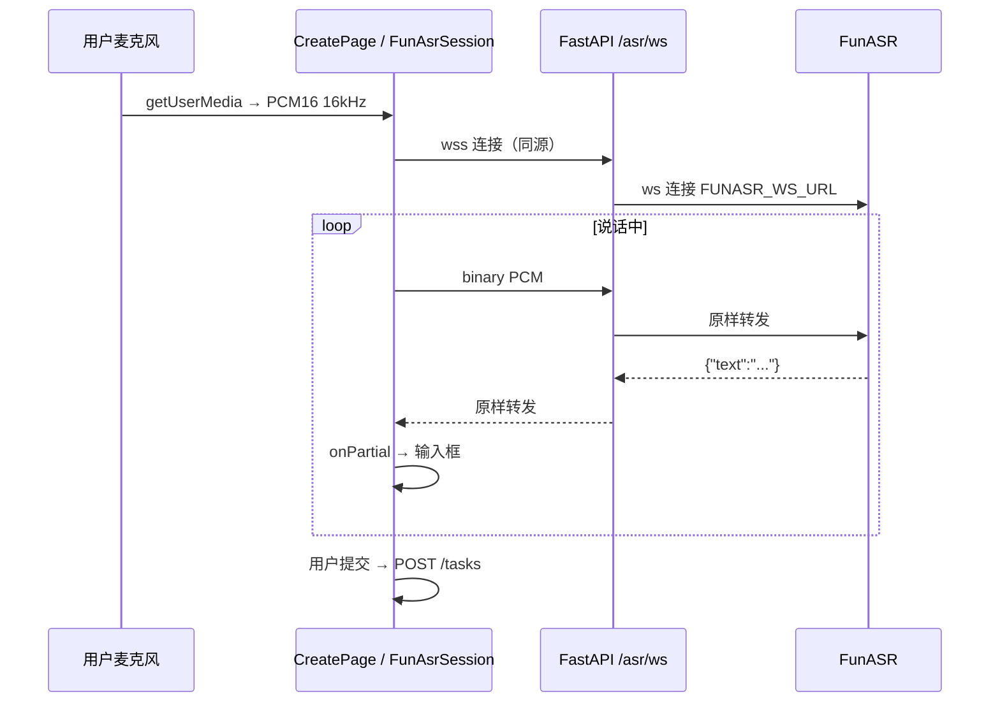
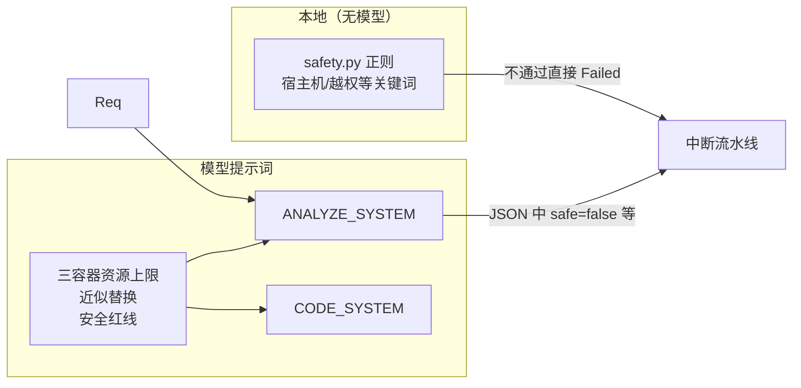
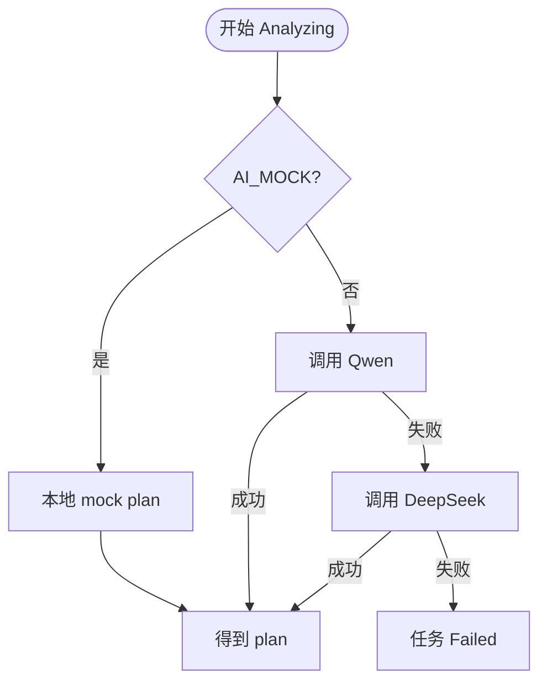

# FlashApp Engine：模型清单与关联机制

本文说明本项目使用的本地模型、统一接入方式，以及它们在「口述即部署」流水线中的协作关系。  
端点参数与 curl 示例见 [local_models.md](./local_models.md)；产品阶段规约见 [prd.md](./prd.md)。

---

## 1. 模型清单

| 能力角色 | 模型 / 服务 | 配置项（Env） | 协议 | 流水线用途 |
|----------|-------------|---------------|------|------------|
| 架构解析（主） | Qwen3.6-35B-A3B | `QWEN_BASE_URL` | HTTP OpenAI 兼容 `/v1/chat/completions` | Analyzing |
| 架构解析（兜底） | DeepSeek-R1-70B | `DEEPSEEK_BASE_URL` | HTTP `/v1/completions` | Analyzing（Qwen 失败时） |
| 代码生成 / 自愈 | Seed-Coder (8B) | `SEEDCODER_BASE_URL` | HTTP `/v1/chat/completions` | Coding；Building/Verifying 失败自愈 |
| 语音转写 | FunASR | `FUNASR_WS_URL` | WebSocket（PCM16 / 16kHz / mono） | 创建任务前的口述输入（非 Celery） |
| 向量嵌入 | Qwen3-VL-Embedding | `EMBEDDING_BASE_URL` | HTTP `/v1/embeddings` | **已封装，未接入主流水线** |
| 文档重排 | Qwen3-VL-Reranker | `RERANKER_BASE_URL` | HTTP `/v1/rerank` | **已封装，未接入主流水线** |
| 节点状态 | 算力地图 Status | `MODEL_STATUS_URL` | HTTP GET | `GET /api/v1/models/status` 探测；**不参与选路** |

模型 ID 常量见 `backend/src/modules/llm/constants.py`。默认 Base URL 见 `backend/src/configs/settings.py` / `backend/.env.example`。

### 已封装但未进业务路径的能力

- **Qwen OCR**（`QwenClient.ocr`）：客户端已实现；创建页上传图片后目前把文件名写入 `images_content`，**Analyzing 不读图、不调 OCR**。
- **Embedding / Reranker**：供后续 RAG 使用；当前无 worker 调用。
- **服务端 `FunASRClient`**：可对 PCM 做批识别；浏览器实时识别走的是 **FastAPI WebSocket 字节转发代理**，不经过该客户端类。

---

## 2. 统一接入：LocalModelGateway

所有 HTTP 模型客户端继承 OpenAI 兼容基类，由门面类聚合，供 Celery Worker / API 注入：

```text
LocalModelGateway
├── qwen        → QwenClient
├── seedcoder   → SeedCoderClient
├── deepseek    → DeepSeekClient
├── embedding   → EmbeddingClient
├── reranker    → RerankerClient
├── funasr      → FunASRClient（服务端 WS 客户端）
└── status      → ModelStatusClient
```

代码入口：`backend/src/modules/llm/__init__.py`（`get_local_model_gateway()` 单例）。



---

## 3. 端到端架构：模型在系统中的位置

用户侧输入（语音 / 文本 / 图片文件）经平台 API 落库后，由 Worker 驱动多阶段编排；模型只参与「理解需求」与「写/修代码」，构建与健康检查由沙箱完成。



---

## 4. 任务流水线与模型分工

阶段枚举：`Received → Analyzing → Coding → Building → Verifying → Success | Failed`（另有生命周期态 `Stopped`）。

| 阶段 | 是否调模型 | 模型 / 机制 | 产出 |
|------|------------|-------------|------|
| 创建前语音 | 是（实时） | FunASR（经同源 WS 代理） | `raw_voice_text` |
| Received | 否 | 入队 Celery | Task 文档 |
| Analyzing 前置 | 否 | 本地正则 `precheck_requirement` | 安全熔断或继续 |
| Analyzing | 是 | **Qwen chat**；失败则 **DeepSeek complete** | 架构 JSON（`summary` / 资源 / 技术栈 / 熔断标记） |
| Coding | 是 | **SeedCoder chat** | `files[]` 代码包 JSON → 落盘 |
| Building | 否* | Docker（或 `SANDBOX_MOCK`） | 容器 / 本地进程 |
| Verifying | 否* | HTTP `/health` | 通过或触发自愈 |
| 自愈 | 是 | **SeedCoder**（最多 1 次） | 修补代码后重试构建/验证 |

\* Building/Verifying 失败时会调用 SeedCoder 自愈，再重试一轮。

### 4.1 编排数据流



### 4.2 Analyzing 时序（含降级）

实现以 **Qwen 为主解析器**（稳定 JSON），DeepSeek 为兜底。  
（早期 PRD 曾写「DeepSeek 做架构」；**以代码为准**：`backend/src/modules/worker/analyzing.py`。）



### 4.3 Coding + 沙箱自愈时序



---

## 5. FunASR：创建路径上的语音模型

FunASR **不参与** Celery 编排，只把口述变成 `raw_voice_text`，再随 `POST /tasks` 入库。

### 为什么要同源代理

手机 PWA 使用 HTTPS 时，浏览器禁止页面直连 `ws://` 内网 FunASR（混合内容）。因此：

1. 浏览器连 **`wss://平台同源/api/v1/asr/ws`**
2. FastAPI 再连上游 **`FUNASR_WS_URL`（通常为内网 `ws://...`）**
3. 双向转发 PCM / JSON 文本

前端默认 URL：`frontend/src/lib/funasr.ts` 的 `getFunAsrWsUrl()`；后端代理：`backend/src/api/asr.py`。



上游不可达时，代理回传错误 JSON，前端可改手动输入，不阻塞创建。

---

## 6. 提示词与熔断关联

模型行为由 `backend/src/modules/worker/prompts.py` 约束，与本地规则预检形成 **双层熔断**：



- **Analyzing**：要求输出严格 JSON（资源分配、技术栈、模块、API 大纲、违规标记）。
- **Coding**：在 plan 约束下输出 `files[]`（路径 + 内容），偏向 FastAPI + 静态/Vite + SQLite。
- **Heal**：把构建/健康检查失败日志与现有文件交给 SeedCoder，要求返回修补后的文件集。

---

## 7. 降级、Mock 与监控

| 机制 | 开关 / 条件 | 作用 |
|------|-------------|------|
| Analyzing 模型降级 | Qwen 抛错 | 自动改调 DeepSeek；无第三级模型 |
| AI Mock | `AI_MOCK=true` | Analyzing/Coding/Heal 走本地假数据，不访问 LLM |
| Sandbox Mock | `SANDBOX_MOCK=true` 或无 Docker | Building/Verifying 不跑真实容器 |
| Celery Eager | `CELERY_TASK_ALWAYS_EAGER` | 同进程跑流水线（常与 AI_MOCK 联调） |
| 模型状态 | `GET /api/v1/models/status` | 拉取 `MODEL_STATUS_URL`；**当前不用于自动选路** |



---

## 8. 关键代码索引

| 主题 | 路径 |
|------|------|
| 配置 | `backend/src/configs/settings.py`、`backend/.env.example` |
| Gateway / 客户端 | `backend/src/modules/llm/` |
| 流水线 | `backend/src/modules/worker/pipeline.py` |
| Analyzing / Coding | `.../worker/analyzing.py`、`coding.py`、`prompts.py`、`safety.py` |
| 沙箱与自愈 | `backend/src/modules/sandbox/service.py`、`heal.py` |
| FunASR 代理 | `backend/src/api/asr.py`；前端 `frontend/src/lib/funasr.ts` |
| 状态 API | `backend/src/api/models.py` |
| 冒烟 | `backend/scripts/smoke_ai_pipeline.py`、`smoke_llm_clients.py` |

---

## 9. 小结

1. **在线编排主链**：FunASR（输入）→ **Qwen**（架构，失败则 **DeepSeek**）→ **SeedCoder**（编码 + 最多一次自愈）→ Docker 验证。  
2. **接入方式**：HTTP 模型经 `LocalModelGateway`；浏览器语音经 **同源 WS 代理** 到 FunASR。  
3. **Embedding / Reranker / OCR**：客户端就绪，**尚未挂入创建或编排主路径**。  
4. **状态探测**可运维查看，**不参与**当前模型选路。  

更细的模型 HTTP/WS 协议与节点地址，请继续阅读 [local_models.md](./local_models.md)。
